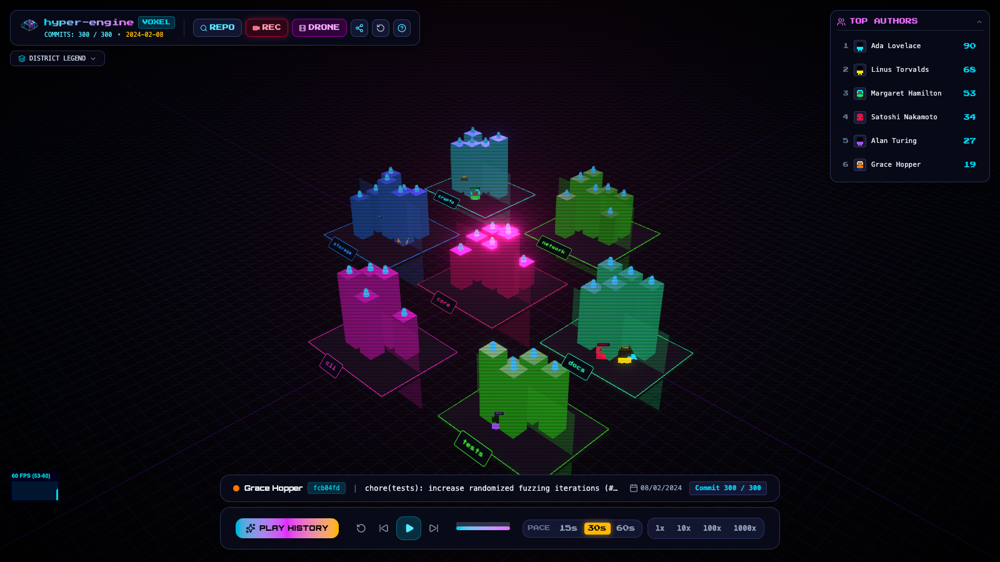
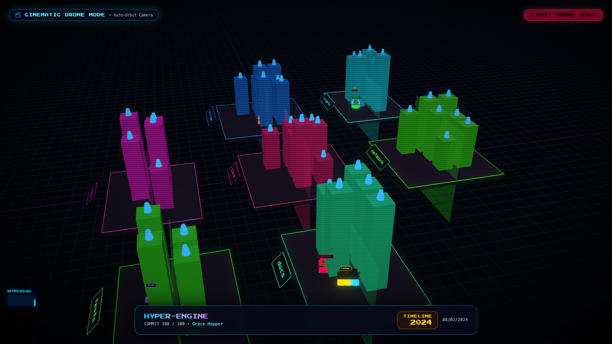
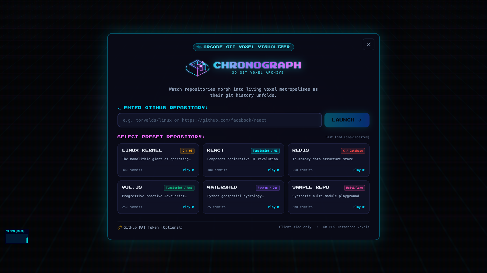

# 🏙️ ChronoGraph

> **Watch any git repository grow into a living neon 3D voxel city.**

ChronoGraph turns Git commit history into an interactive retro-synthwave voxel world. Top-level folders become floating neon islands, files sprout as voxel skyscrapers that grow taller with every commit touch, and top contributors roam as procedural 8-bit avatars building their territories.

[](LICENSE)
[](https://vitejs.dev/)
[](https://react.dev/)
[](https://threejs.org/)
[](https://developer.mozilla.org/en-US/docs/Web/API/Web_Audio_API)

---



---

## ⚡ Key Features

- **🌆 Procedural Voxel Metropolis**: Folders partition into floating islands via deterministic spiral packing. Files map to instanced voxels that rise, grow, and crumble on deletion.
- **👾 8-Bit Contributor Avatars**: Top contributors get procedurally generated pixel-art avatars that walk to files on commit and hammer upgrades with floating `+N` badges.
- **🎥 Cinematic Drone Mode**: Auto-orbit camera with dramatic fly-bys during merge commits and big changes. Seamless 0.6s exit back to OrbitControls (`Esc`).
- **📹 1080p Video Recording**: Export crisp 60 FPS videos directly from the browser canvas using `MediaRecorder` with intro and outro title cards.
- **🔊 8-Bit Retro Sound**: Zero-dependency Web Audio synthesizer with commit ticks, earthquake bass impacts, and background synthwave chord progression.
- **⚡ Web Worker Layout Computation**: Tree computation, touch metrics, and layout packing run off the main thread for 60 FPS playback.
- **🕹️ Arcade HUD & Scrubber**: Full playback control (1x, 10x, 100x, 1000x), auto-pace duration targeting (15s, 30s, 60s), and shareable URLs (`?repo=owner/name&t=0.4`).

---

## 🎮 Keyboard Controls & Shortcuts

| Key | Action |
|---|---|
| `Space` | Play / Pause timeline playback |
| `←` / `→` | Step backward / forward 1 commit |
| `Esc` | Exit Drone Mode / Close modal dialogs |
| `D` | Toggle Cinematic Drone Mode |
| `R` | Reset camera to default isometric view |
| `M` | Toggle sound effects & synth ambience |
| `H` or `?` | Toggle Controls & Shortcuts help overlay |
| `Click` | Select building file or district island |
| `Drag` | Orbit 3D camera / Scrubber seek |

---

## 🚀 Quick Start

### 1. Run Locally
```bash
git clone https://github.com/AdityaBanavali/Chrono-graph.git
cd Chrono-graph
npm install
npm run dev
```

Visit `http://localhost:5173/` in your browser. The pre-bundled dataset (`hyper-engine`) loads automatically.

### 2. Ingest Any Local Git Repository
Use `scripts/ingest.mjs` to convert any Git repository into ChronoGraph's streaming JSON format:

```bash
node scripts/ingest.mjs <path-to-local-git-clone> <out.json> [--max-commits N]
```

#### Examples:
```bash
# Redis (~1,000 commits sampled)
git clone --depth 10000 https://github.com/redis/redis.git /tmp/redis
node scripts/ingest.mjs /tmp/redis public/data/redis.json --max-commits 1000

# React (~1,500 commits sampled)
git clone https://github.com/facebook/react.git /tmp/react
node scripts/ingest.mjs /tmp/react public/data/react.json --max-commits 1500

# Linux Kernel (~2,000 commits sampled)
git clone --bare https://github.com/torvalds/linux.git /tmp/linux.git
node scripts/ingest.mjs /tmp/linux.git public/data/linux.json --max-commits 2000
```

---

## 📸 Screenshots

| Cinematic Drone Mode | Arcade Landing & Repository Picker |
|---|---|
|  |  |

---

## 🚢 Deploying to Vercel

ChronoGraph is configured for one-click deployment on Vercel:

```bash
npx vercel
```

`vercel.json` includes client-side SPA routing and optimal caching headers out of the box.

---

## 🛠️ Architecture

- **`src/world/`**: Three.js & React Three Fiber scene, instanced building voxels, district terrain meshes, camera transitions, and Web Worker layout client.
- **`src/data/`**: Streaming Git ingest parser, GitHub REST API client with IndexedDB caching, Web Audio synthesizer, and canvas video recorder.
- **`src/ui/`**: CRT Arcade Tailwind UI, timeline scrubber, HUD overlays, procedural SVG logo system, and modals.
- **`src/store/`**: Lightweight Zustand stores for repository state, timeline frame position, UI overlays, and quality settings.

---

## 📄 License

This project is licensed under the [MIT License](LICENSE).
