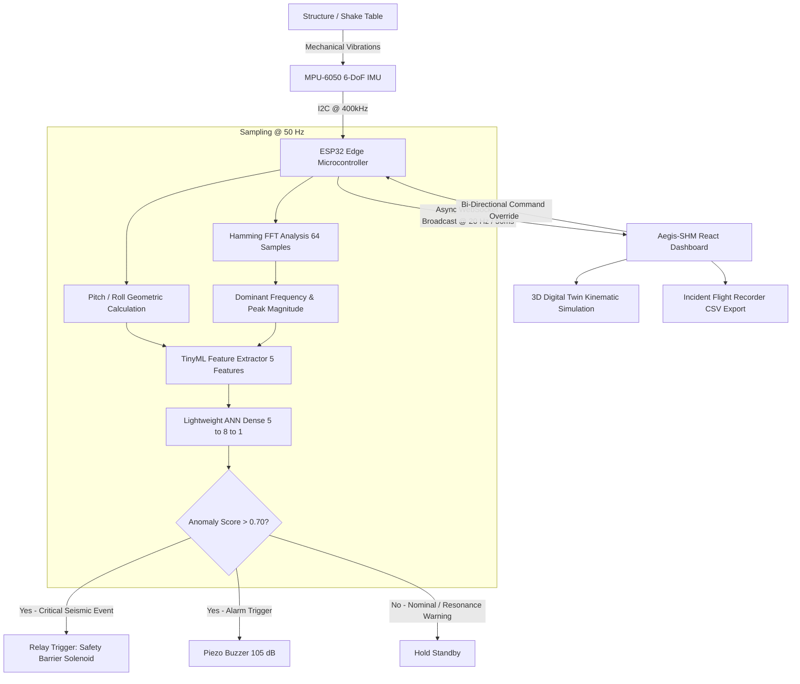

# Aegis-SHM // Edge Structural Health & Seismic Hazard Monitor

[](https://www.espressif.com/)
[](https://github.com/AdityaBanavali/StrStat)
[](https://react.dev/)
[](https://threejs.org/)
[](https://tailwindcss.com/)
[](LICENSE)

An industrial-grade, dark-mode cyber-physical telemetry dashboard and edge computing system designed for real-time Structural Health Monitoring (SHM), mechanical resonance detection, and automated seismic hazard mitigation.

Powered by an **ESP32** running an on-device **TinyML Multi-Layer Perceptron (ANN)** and **Fast Fourier Transform (FFT)** connected to an **MPU-6050** 6-DoF sensor, streaming live packets to a high-density mission-control React console featuring a real-time 3D kinematic digital twin.

---

## System Architecture



---

## Mechanical Engineering Concepts

This platform integrates fundamental structural mechanics, vibration analysis, and earthquake engineering principles:

### 1. Structural Dynamics & Harmonic Resonance
* **Equation of Motion (SDOF & MDOF Systems):**
  $$m\ddot{x}(t) + c\dot{x}(t) + kx(t) = F(t)$$
  where $m$ is structural mass, $c$ is viscous damping, and $k$ is lateral frame stiffness.
* **Natural Frequency ($f_n$):**
  $$\omega_n = \sqrt{\frac{k}{m}}, \quad f_n = \frac{1}{2\pi}\sqrt{\frac{k}{m}}$$
  The experimental structure has a calibrated fundamental mode around $f_n \approx 3.20\text{ Hz}$ to $4.00\text{ Hz}$.
* **Resonance Catastrophe & Dynamic Magnification:**
  When external excitation frequency ($f_{\text{exc}}$) matches natural frequency ($f_{\text{exc}} \approx f_n$), the Dynamic Magnification Factor (DMF) reaches peak:
  $$\text{DMF} = \frac{1}{\sqrt{\left(1 - \beta^2\right)^2 + (2\zeta\beta)^2}} \quad \xrightarrow{\beta = 1} \quad \frac{1}{2\zeta}$$
  where $\beta = \frac{f_{\text{exc}}}{f_n}$ and $\zeta$ is the damping ratio. Unchecked resonance generates massive bending moments, cyclic fatigue, and shear failure.

### 2. Stiffness Degradation & Natural Frequency Drift ($\Delta f$)
* Structural micro-cracking, joint fatigue, and plastic yielding decrease effective stiffness ($k_{\text{eff}} < k_0$).
* This degradation produces downward shift in the resonant frequency, monitored continuously by:
  $$\text{Drift (\%)} = \frac{f_{\text{current}} - f_0}{f_0} \times 100\% \quad (f_0 = 4.0\text{ Hz nominal baseline})$$
* Shifts exceeding $\pm 15\%$ indicate stiffness loss or structural damage.

### 3. Tri-Axial Ground Motion & Peak Ground Acceleration (PGA)
* **Acceleration Vector Norm:**
  $$\|\mathbf{a}\| = \sqrt{a_x^2 + a_y^2 + a_z^2}$$
* **DC Gravity Separation & Dynamic/AC Acceleration:**
  Earth's static $1.0g$ datum is subtracted to isolate pure dynamic earthquake acceleration:
  $$\text{PGA} = \max\left(0, \|\mathbf{a}\| - 1.0g\right)$$
  In the SCADA oscilloscope, the dynamic component $a_{z,\text{dyn}} = a_z - 1.0g$ is separated so that all three axes oscillate symmetrically around the $0.0g$ datum during rest.
* **Instrumental Seismic Intensity Mapping (USGS / MMI):**
  Calculated PGA ($g$) is mapped in real time to the Modified Mercalli Intensity scale (MMI I through X) to categorize damage hazard from *Imperceptible* ($< 0.0017g$) up to *Violent* ($0.65 - 1.24g$) and *Extreme* ($\ge 1.24g$).

### 4. Nyquist-Shannon Sampling & Frequency-Domain FFT Analysis
* **Nyquist Criterion:**
  For an IMU sampling rate of $f_s = 50\text{ Hz}$, the maximum observable frequency (Nyquist limit) is:
  $$f_{\text{Nyquist}} = \frac{f_s}{2} = 25.0\text{ Hz}$$
* **Spectral Windowing:** An on-chip 64-sample Hamming windowed Discrete Fourier Transform decomposes the raw acceleration signal into discrete spectral bins with power magnitude in $g^2/\text{Hz}$.
* **Hazard Zone Highlighting:** Civil and structural vibration hazards typically concentrate in the $1.0\text{ Hz} - 8.0\text{ Hz}$ band, visually bounded by threshold lines on the dashboard spectrum.

### 5. Multi-Story Cantilever Shear Frame Kinematics
* In multi-story framed buildings, lateral seismic force produces inter-story drift $\Delta_i = u_i - u_{i-1}$.
* Upper floors undergo amplified cantilever lateral sway:
  $$u(y) \propto \left(\frac{y}{H}\right)^\alpha$$
* The 3D Digital Twin simulates this dynamic shear displacement by deflecting story levels along $X$ and $Z$ as a function of instantaneous acceleration magnitude and dominant excitation frequency.
* **Diagonal Cross-Bracing Mechanics:** Tensile and compressive diagonal truss members resist lateral shear loads and reduce inter-story drift ratios.

### 6. Static Tilt & Euler Angle Geometry
* Static angular pitch ($\theta$) and roll ($\phi$) are derived from gravity vector projections:
  $$\theta = \arctan\left(\frac{a_x}{\sqrt{a_y^2 + a_z^2}}\right), \quad \phi = \arctan\left(\frac{a_y}{\sqrt{a_x^2 + a_z^2}}\right)$$
  Permanent post-tremor angular offset identifies foundation settlement, column tilt, or permanent plastic deformation.

---

## Key Capabilities

- **Strict Zero-Fake-Data Watchdog:** If no WebSocket packet arrives for $> 1500\text{ ms}$, `isConnected` drops to `false` and chart streams freeze with a `"DATA STREAM SEVERED"` badge.
- **Edge TinyML Inference:** Sub-millisecond ANN classification on the microcontroller predicting structural collapse or seismic excursions before catastrophic failure occurs.
- **On-Chip Harmonic FFT Engine:** Real-time extraction of dominant excitation frequency ($f_{\text{exc}}$) over the full $0.0 - 25.0\text{ Hz}$ Nyquist window.
- **Dynamic Z-Axis Isolation:** DC static gravity offset ($1.0g$) is removed for dynamic waveform visualization ($a_{z,\text{dyn}} = a_z - 1.0g$) while displaying both raw and dynamic magnitudes.
- **3D Digital Twin Viewer:** Real-time Three.js/R3F structural model with continuous pitch/roll lerp smoothing, multi-story shear deformation, and emergency seismic pulse.
- **Incident Flight Recorder:** Automatically buffers 15 seconds of raw data snapshots when a `SEISMIC_EVENT` is detected, exportable as an earthquake seismogram `.csv`.
- **Fail-Safe Physical Actuation:** Automated relay driving an emergency barrier solenoid with hardware limit-switch indicator and operator override over WebSocket.

---

## Hardware Specification & Wiring Pinout

| Peripheral | ESP32 Pin | Function | Notes |
| :--- | :--- | :--- | :--- |
| **MPU-6050 SDA** | `GPIO 21` | I2C Data | FastMode 400 kHz with pull-ups |
| **MPU-6050 SCL** | `GPIO 22` | I2C Clock | FastMode 400 kHz with pull-ups |
| **Relay Solenoid** | `GPIO 23` | Safety Barrier Driver | Active HIGH trigger |
| **Piezo Buzzer** | `GPIO 19` | Audible Siren Alarm | Active HIGH trigger (105 dB) |
| **Status LED** | `GPIO 2` | Heartbeat & System Health | Blinks on boot, solid when active |

---

## Edge TinyML Model Specification

The ESP32 runs a custom forward-propagation inference neural network directly in C++ without heavy framework dependencies:

```
Input Vector [5] ──► Dense [8, ReLU] ──► Dense [1, Sigmoid] ──► Anomaly Score (0.00 - 1.00)
```

### Input Feature Tensor
1. `x[0]`: Dynamic Normalized Acceleration Magnitude ($g$)
2. `x[1]`: Absolute Angular Pitch Deflection ($\text{deg} / 45^\circ$)
3. `x[2]`: Absolute Angular Roll Deflection ($\text{deg} / 45^\circ$)
4. `x[3]`: FFT Dominant Frequency Ratio ($f_{\text{exc}} / 25\text{ Hz}$)
5. `x[4]`: Peak Spectral Amplitude Magnitude

### Operational State Brackets

| Anomaly Score | System State | Hardware & Dashboard Response |
| :--- | :--- | :--- |
| **$< 0.40$** | `NOMINAL` | Solenoid retracted, buzzer silent, green status pill |
| **$0.40 - 0.70$** | `RESONANCE_WARNING` | Elevated harmonic excitation alert, amber banner |
| **$\ge 0.70$** | `SEISMIC_EVENT` | **Instant barrier trip (GPIO 23)**, acoustic siren (GPIO 19), 15s incident flight recording |

---

## WebSocket Telemetry Protocol

Live JSON payload broadcast by the ESP32 over `ws://<ESP32_IP>/ws` every 50 ms:

```json
{
  "connected": true,
  "timestamp": 1728749280123,
  "imu": {
    "accel": { "x": 0.021, "y": -0.014, "z": 0.982 },
    "tilt": { "pitch": 1.20, "roll": -0.40 }
  },
  "fft": {
    "dominant_freq_hz": 4.20,
    "peak_magnitude": 0.180
  },
  "inference": {
    "anomaly_score": 0.120,
    "probability": 0.120,
    "state": "NOMINAL",
    "inference_latency_ms": 14
  },
  "actuator": {
    "safety_barrier_deployed": false,
    "buzzer_state": false
  }
}
```

### Manual Command Payload (Dashboard ➔ ESP32)
```json
{
  "toggle_actuator": true
}
```

---

## Quickstart Guide

### 1. ESP32 Firmware Setup

1. Open [`esp32/esp32.ino`](esp32/esp32.ino) in Arduino IDE or PlatformIO.
2. Install required Arduino libraries:
   - `Adafruit MPU6050`
   - `Adafruit Unified Sensor`
   - `ArduinoJson` (v6+)
   - `arduinoFFT` (v2+)
   - `ESPAsyncWebServer`
   - `AsyncTCP`
3. Update Wi-Fi credentials:
   ```cpp
   const char *WIFI_SSID = "YOUR_WIFI_SSID";
   const char *WIFI_PASSWORD = "YOUR_WIFI_PASSWORD";
   ```
4. Flash to your ESP32 board and open Serial Monitor at `115200 baud` to note the assigned IP address.

### 2. Frontend Dashboard Setup

```bash
# Clone the repository
git clone https://github.com/AdityaBanavali/StrStat.git
cd StrStat

# Run one-shot setup script (installs dependencies and starts dev server)
./dev.sh
```

Alternatively via npm:

```bash
npm install
npm run dev
```

Visit `http://localhost:5173/` in your browser. Enter your ESP32 IP in the **NODE** input field to begin streaming live telemetry.

---

## Project Structure

```
.
├── dev.sh                           # Automated environment launch script
├── index.html                       # HTML5 entry point
├── package.json                     # NPM package configuration
├── tsconfig.json                    # TypeScript compilation rules
├── tailwind.config.js               # Technical palette configuration
├── esp32/
│   └── esp32.ino                    # High-frequency sampling & TinyML firmware
└── src/
    ├── main.tsx                     # React DOM bootstrapping
    ├── index.css                    # Technical typography & styling tokens
    ├── types.ts                     # Telemetry & incident snapshot interfaces
    ├── App.tsx                      # 2-column command console layout
    ├── hooks/
    │   └── useEspTelemetry.ts       # Zero-fake-data watchdog & flight recorder hook
    ├── utils/
    │   └── structuralMath.ts        # PGA, MMI mapping, & resonant drift math
    └── components/
        ├── DigitalTwinViewer.tsx    # 3D R3F multi-story shear frame simulation
        ├── TelemetryGraph.tsx       # SCADA tri-axial oscilloscope with dynamic Z
        ├── ResonanceSpectrum.tsx    # Full 0-25 Hz Nyquist resonance analyzer
        ├── TiltVisualizer.tsx       # Digital bubble reticle
        ├── InferenceCard.tsx        # TinyML anomaly gauge & latency indicators
        ├── ActuatorStatus.tsx       # Fail-safe solenoid driver with limit-switch pill
        └── EventLog.tsx             # Monospaced audit log & CSV exporter
```

---

## License

Distributed under the **MIT License**. See [`LICENSE`](LICENSE) for complete terms.
